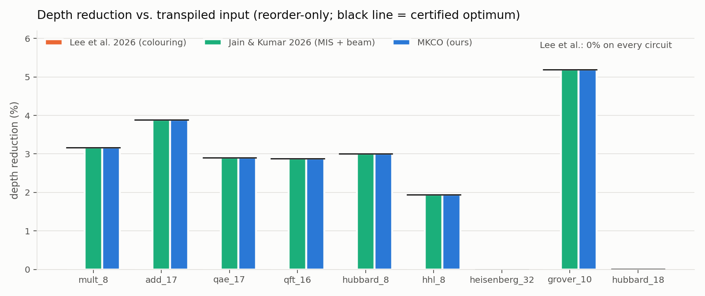
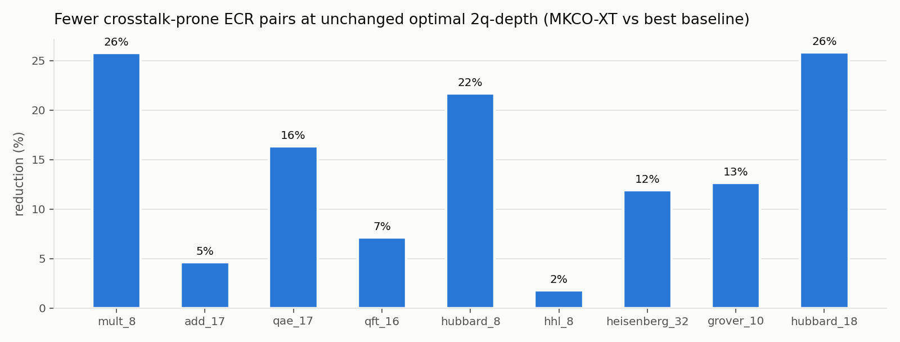
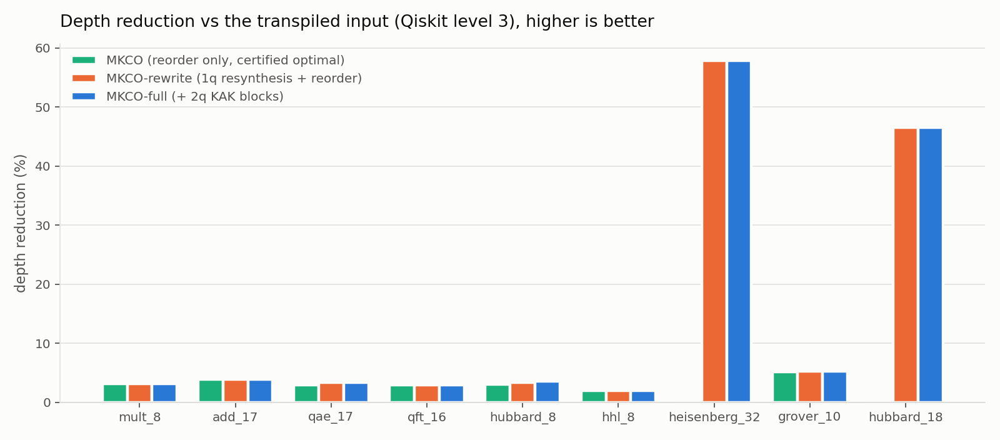
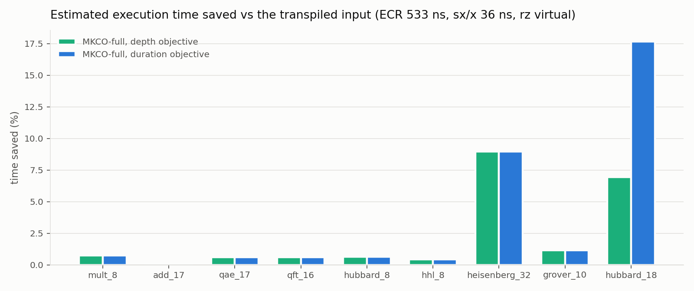
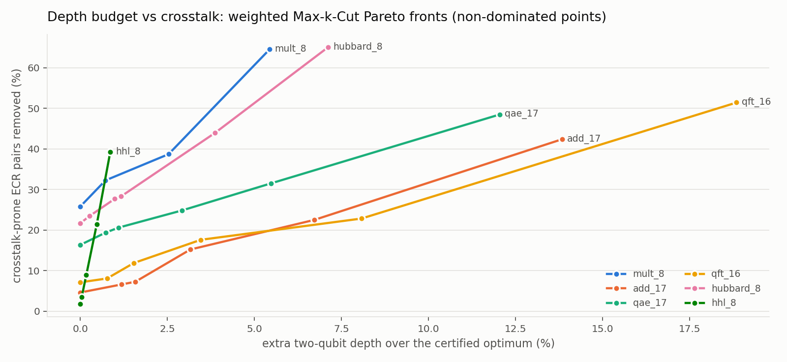
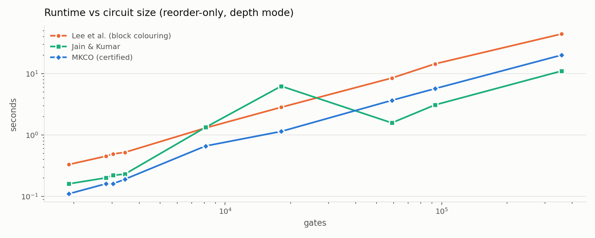

**Reorder-only depth (Table 1).**
- **Lee et al.** gains nothing on any of the 9 circuits. After transpilation,
  maximal blocks of mutually commuting gates are short, and colouring each block
  separately cannot move a gate across a block boundary.
- **MKCO** reorders across the whole circuit. Depth drops by 2.9–5.2% on 7
  circuits (grover_10: −2,282 layers), and the result equals the certified
  lower bound on **all 9**. These depths are therefore *provably optimal*:
  no reordering method, present or future, can do better on these inputs.
- **heisenberg_32** is proven to be already optimal as transpiled.
- **hubbard_18** had only 7 layers of headroom out of 136,644.
- **Jain & Kumar** (our re-implementation) reaches the same depths, as any
  sound commutation-aware layering must once the instance is this easy. It
  cannot certify them, and in depth mode it raises the 2q-depth of add_17 by 2.

**Two-qubit depth (Table 2).** In 2q mode MKCO is certified optimal on 9/9.
Seven circuits were already optimal as transpiled; hubbard_8 (−1) and
hubbard_18 (−3) improve.

**Crosstalk at optimal 2q-depth (Table 3): the Max-Cut-only capability.**
- No colouring-based method can express "prefer not to run these two ECRs
  together". All three baselines leave the crosstalk-prone pair count where
  the transpiler put it.
- With the 2q-depth pinned at its certified optimum, the weighted Max-k-Cut
  spends the available slack on soft edges. It removes **1.8–25.9%** of
  neighbouring-coupler ECR pairs (mean 14.2%; hubbard_18: −1,897 pairs, −25.9%).
- The cost: the anchor barriers that lock the layering add 0.8–7.6% total
  depth, but only 0.0–0.9% estimated duration, because ECRs dominate execution
  time.

**Gate rewriting (Table 4).** The inputs are already Qiskit's output at
optimization level 3, so the reference is the input itself; re-running
Qiskit O3 on them would not be a meaningful baseline.
- **MKCO-full is shallower than the input on all 9 circuits** (−1.9% to
  −57.8%). Every MKCO result is certified optimal for the gate list it
  reorders.
  - The two Hamiltonian-simulation circuits gain most: heisenberg_32
    7,143 → 3,011 (−57.8%), hubbard_18 136,644 → 72,992 (−46.6%).
  - Their transpiled rz/sx chains collapse under single-qubit resynthesis.
    MKCO's run-based merging then gathers same-axis rotations *across*
    commuting ECRs, which the level-3 transpiler's adjacent-gate passes did
    not do.
- On the other 7 circuits rewriting adds little to reordering (at most 27
  layers).

**Hardware time.** Total depth counts virtual rz layers, so the
hardware-relevant figure is estimated execution time.
- Selecting among MKCO's candidates by estimated duration, MKCO-full is
  **faster than the input on all 9 circuits**: −0.1% to −1.1% on 7, −9.0% on
  heisenberg_32 and −17.7% on hubbard_18.
- On hubbard_18 it also lowers two-qubit depth (21,769 → 18,795) and the ECR
  count (33,958 → 30,453, −10.3%).
- Depth- and duration-optimal choices differ on hubbard_18. The 1q-only
  pre-pass gives the smallest total depth (72,992). KAK block resynthesis
  gives the fewest ECRs and the shortest time.

**Two-qubit block (KAK) resynthesis (Table 8).**
- The transpiled circuits are already ECR-optimal block by block on 7 of 9
  benchmarks (0–58 cheaper blocks).
- On heisenberg_32 and hubbard_18, KAK finds 1,073 and 4,856 cheaper blocks.
  On hubbard_18 it removes 3,505 ECRs.
- *Locally* cheaper blocks are not automatically better globally. On
  heisenberg_32 the KAK branch is 33% deeper than 1q-only (3,998 vs 3,011),
  because generic KAK output pins single-qubit layers on both wires and
  destroys the cross-block merging the run model exploits. MKCO therefore
  evaluates both branches after Max-k-Cut reordering and keeps the better one.

**Depth budget vs crosstalk (Table 9).** This is Theorem 2's depth-budget
form in action. The certified-optimal layering is stretched
order-preservingly to k* + s layers, and the weighted Max-k-Cut spends the
slack on soft edges.
- With s = 0 (no depth cost), crosstalk-prone pairs fall 2–26%.
- With 10% slack they fall 21–44%; with 20% slack, 39–65%.
- Estimated execution time grows by 1–19% along these fronts. The fronts let
  a user choose the operating point that fits their device's crosstalk to
  coherence ratio.
- The search is time-limited, so a few measured points are dominated; the
  figure plots the non-dominated ones and Table 9 lists all of them.

**Correctness (Table 7).** All reordered outputs (117 audits) pass the independent
commutation audit (14,222 reordered gate pairs checked on grover_10 alone).
Every MKCO output with ≤ 20 active qubits also matches the input under
state-vector simulation (fidelity 1 to 10 digits, global phase consistent).

**Runtime (Table 6).** Reorder-only MKCO runs in 0.1–20 s, faster than
block-wise colouring on every circuit and comparable to Jain & Kumar.
- The crosstalk mode uses its time budget (30–60 s).
- MKCO-full evaluates two pre-pass branches and takes up to 6 minutes on the
  358k-gate hubbard_18.
