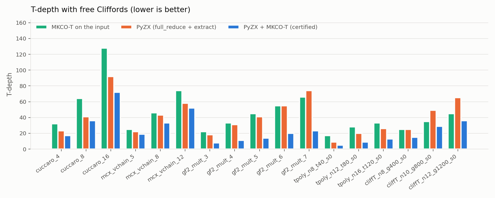
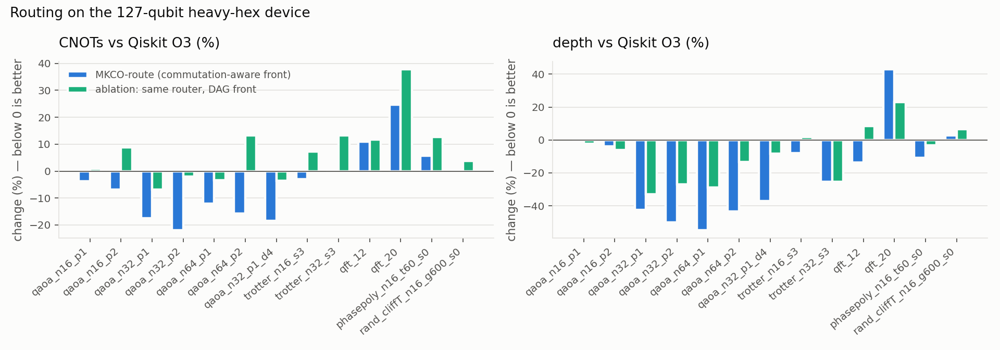
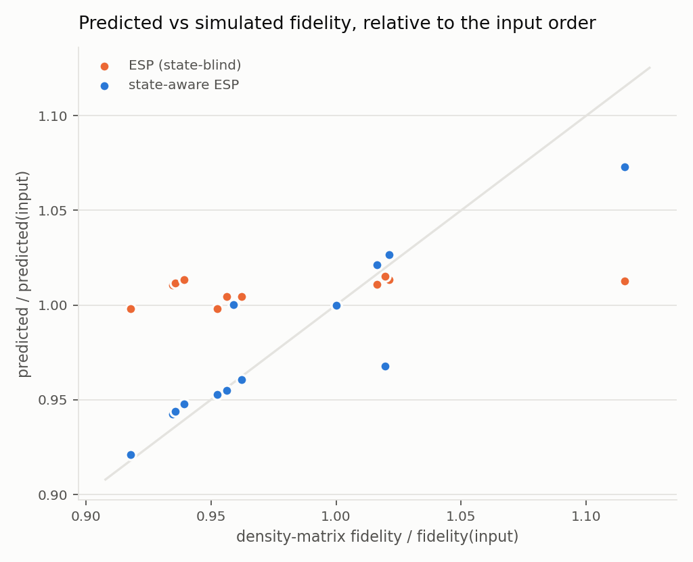

The same machinery (trace order, mixed graph, certified layering) carries
over to four further problems. Each one is implemented, tested and evaluated
against an established tool.

### 7.1 Non-Clifford depth with free Cliffords (E8)

In fault-tolerant execution, the expensive layers are those containing T
gates (or Toffolis); Clifford gates are cheap. `mkco.nonclifford` minimises
the *counted* depth: T-like rotations, Toffolis, or any non-Clifford rotation.
Counted gates take one step; Clifford gates take none, but still synchronise
their wires (the usual T-depth).
- **Reduction (Proposition 10).** This is a mixed-graph colouring on the
  counted gates. Its arcs come from the trace order through the free gates.
- **Solver.** A surrogate circuit with one private virtual wire per
  free-path pair lets the *unchanged* MKCO engine solve it, including the
  certified Jackson bound.
- **Merging.** Rotation merging (T·T = S) runs first.

- **On its own**, MKCO-T lowers the T-depth of the GF(2ⁿ) multipliers by
  39–44% (e.g. gf2_mult_7: 108 → 66), and of T phase polynomials by 23–30%.
  It is certified optimal on 14 of the 17 T-depth instances; the three random
  Clifford+T circuits stay uncertified.
  - Ripple-carry (Cuccaro) adders are inherently sequential. MKCO proves that
    no reordering helps (certified = original).
  - Plain depth-minimising MKCO is worse on T-depth (e.g. cuccaro_16: 144 vs
    128), so the objective matters.
- **After PyZX** (full_reduce + extract), the strongest T-*count* tool we
  could run, MKCO-T cuts PyZX's T-depth by 10–69% (mean 41%) on all 17
  T-depth instances. Every one of these results is certified optimal.
  Examples:
  - gf2_mult_7: 74 → 23;
  - T phase polynomial n=16: 26 → 13;
  - random Clifford+T n=12: 65 → 36.
- **Toffoli-depth** of the multipliers drops by 53–64%
  (gf2_mult_12: 64 → 23).
- All 103 outputs with ≤ 20 qubits pass the state-vector check.

### 7.2 Commutation-aware routing + layering (E9)

`mkco.route` is a SABRE-style router (bidirectional layout search, lookahead,
decay) with one change: a gate enters the front layer as soon as the previous
run on each of its wires has executed.
- Mutually commuting gates (a whole QAOA cost layer) therefore all compete for
  execution.
- Two front scorings run as a small portfolio: the mean over front gates, and
  each qubit's nearest front gate (gates sharing a qubit run one after another
  anyway).
- After routing, MKCO layers the circuit, re-synthesises blocks (KAK) and
  layers it again. The trial with the smallest CNOTs + depth is kept.
- Every output passes the exact `unroute` check (Proposition 11) and the
  coupling check.
- The comparison is Qiskit's transpiler at optimization level 3 ("Qiskit
  O3": SabreLayout + SabreSwap + its optimisation loop) on IBM Eagle's
  127-qubit heavy-hex graph, at CNOT level. Unlike the IBM benchmarks, these
  are untranspiled logical circuits, so Qiskit's level-3 routing is the
  natural baseline here.

- **QAOA** (7 instances, 16–64 qubits, degree 3–4, p = 1–2), where whole
  cost layers commute: MKCO-route uses **3.8–21.9% fewer CNOTs** than Qiskit O3
  on all 7, and is **up to 55% shallower**. Depth is equal on one instance.
  - qaoa_n64_p1: 638 vs 726 CNOTs, depth 80 vs 177.
  - qaoa_n32_p2: 449 vs 575 CNOTs, depth 96 vs 193.
- **Trotter Ising** (CNOT–Rz–CNOT form): 2.9% fewer CNOTs and 7.9% shallower
  at n = 16; at n = 32, equal CNOTs (+0.2%) and 25% shallower.
- **QFT is Qiskit's case.** QFT-12 costs 11% more CNOTs (but is 14%
  shallower); QFT-20 costs 25% more CNOTs and is 43% deeper.
- **Phase polynomial and random Clifford+T:** within +0.6% to +5.6% CNOTs;
  the phase polynomial is 11% shallower, the random circuit 2.6% deeper.
- **Ablation.** With the plain gate-DAG front (standard SABRE) and everything
  else identical, the router needs more CNOTs on **all 13** circuits
  (e.g. qaoa_n64_p2: 1583 vs 1177). The gain therefore comes from the
  commutation-aware front.
  - The QFT gap is a weakness of our SABRE base relative to Qiskit's tuned
    implementation: the ablation is even further behind there.
- **Composition.** MKCO's post-routing passes applied to Qiskit's output
  ("Qiskit O3 + MKCO") lower Qiskit's depth on all 13 circuits (e.g. random
  Clifford+T 571 → 512, Trotter-16 164 → 140), at equal or lower CNOT count.

### 7.3 Commutation-aware block formation for KAK (E11)

Block resynthesis (here and in Qiskit's ConsolidateBlocks) only sees blocks
that are contiguous on the gate DAG. A gate that commutes past a block still
splits it. `regroup_pairs` applies a legal reordering (a linear extension of
the trace order, checked) that keeps the gates of one qubit pair together, in
a forward and a backward pass, before block KAK.
- On 19 logical (untranspiled) circuits it removes CNOTs on 17 relative to
  plain block KAK, and never adds any. Against Qiskit's level-3 optimiser on
  the same logical circuits (CX basis) it is on par in CNOTs, and its outputs
  are shallower after MKCO layering on the Trotter, QAOA and random circuits.
  Applied after Qiskit, it removes further CNOTs on 5 circuits.
- On the IBM benchmarks (Table 11) the level-3 transpiler has already merged
  every block that commutation could join. Only hubbard_8 gains (4 ECRs).
- Qiskit's KAK decomposer silently snaps near-identity blocks (e.g. a
  controlled phase of angle 5·10⁻⁵ in QFT-20) to cheaper, inexact circuits,
  even with `approximate=False`. MKCO's exact check rejects those
  replacements.

### 7.4 Noise study with device calibration data (E10)

The 9 benchmarks are native to ibm_brisbane: all 78 ECR directions match the
FakeBrisbane snapshot in qiskit-ibm-runtime. Every method's output is
therefore scored with that device's calibrated per-gate errors and durations,
T1, T2 and readout errors (`mkco.noise`, Table 10):
- an ESP with ALAP idling;
- a state-aware ESP;
- for circuits with ≤ 8 active qubits, exact density-matrix simulation at
  calibrated noise and at 10× lower noise.

- **Depth is not fidelity.** All reorderings of a circuit have the same gate
  noise; switching idle noise off makes their simulated fidelities equal
  (mult_8: 0.708 for all). The differences come from idling, mainly from
  dephasing of qubits that wait in superposition. As a result, a
  depth-optimal order can be less *or* more faithful than the input:
  - mult_8: MKCO's order loses 4.4% state fidelity at 10× lower noise
    (0.542 vs 0.567), although it is 1% shorter;
  - hhl_8: it gains 12% (0.0138 vs 0.0123).
- **The state-aware ESP sees this; the usual ESP does not.** Over all pairs of
  methods on the 3 simulated circuits, the state-aware ESP orders the pair as
  the density-matrix simulation does in **95%** of cases at 10× lower noise
  (84% at calibrated noise, where fidelities approach the noise floor). The
  state-blind ESP manages 70% (57%).
- **`mkco_noise` picks the output by state-aware ESP.** Candidates are MKCO's
  orders, their ALAP variants and the input. Under the best available score
  it never falls below the input, and is above it on 8 of 9 circuits:
  - simulated fidelity: equal on mult_8 (it keeps the input order), +2%
    (hubbard_8), +12% (hhl_8);
  - state-aware ESP: +1–2% (add_17, qae_17, qft_16), ×4.7 (grover_10);
  - ESP (too large to simulate): ×2.1 (heisenberg_32); ×205 (hubbard_18,
    with 3,505 fewer ECRs than the input and an 18% shorter schedule).
  It also scores at least as well as Jain & Kumar's output on every circuit.
- **Crosstalk mode under a timing model.** Its objective counts
  neighbouring-coupler pairs *in the same layer*. With calibrated durations
  and ALAP timing, ECRs of different layers overlap in time, so the layer
  proxy does not carry over. Under ESP_xt (an extra ECR error for every
  time-overlapping neighbouring pair), mkco_xt beats plain MKCO only on
  hubbard_18 (×24). A duration-aware crosstalk objective is future work.
- **Independent check on a noisy simulated backend (Table 12).** The three
  8-qubit circuits were also run end to end as on hardware, on a simulated
  noisy backend:
  - Qiskit's ALAP scheduling, then Aer with its standard noise model built
    from the same ibm_brisbane calibration (`NoiseModel.from_backend`). This
    model shares no code with `mkco.noise`.
  - 32,768 shots per circuit, all methods interleaved in one job, at
    calibrated and at 10× lower noise.
  - On the method pairs that sampling separates, at 10× lower noise,
    `mkco.noise`'s density-matrix model and the state-aware ESP order **7/7**
    pairs correctly. The state-blind ESP gets 3/7, worse than chance, because
    it rewards the shorter orders.
  - At calibrated noise, where the circuits sit near the noise floor, the
    scores are 4/4, 4/4 and 2/4.
  - Measured at 10× lower noise, `mkco_noise` reproduces the predicted
    winners. Its circuit is measured twice, as itself and as the method it
    selects, so the pair of numbers shows the sampling spread:
    - mult_8: it keeps the input order (0.546–0.548), while plain MKCO
      drops to 0.513;
    - hubbard_8: 0.073–0.074, against 0.070 for the input and 0.065 for
      plain MKCO;
    - hhl_8 (MKCO-full): 0.072–0.075, against 0.072 for the input.
  - Larger circuits:
    - add_17 and qae_17 (17 qubits, outputs concentrated on 1 and 4
      bitstrings) were sampled at 10× lower noise: 512 shots per version,
      quantum-trajectory simulation at about 0.85 s per shot. With 512 shots the 95% intervals span about
      ±0.03, wider than the 1–2% differences the model predicts. Results
      (versions: input, plain MKCO, noise-aware MKCO):
      - qae_17: the measured order is the one the state-aware ESP predicts
        (noise-aware MKCO 0.353 > plain MKCO 0.305 > input 0.280), though the
        intervals overlap. The Hellinger values exceed the predicted state
        fidelities because phase errors do not show in counts taken in the
        computational basis.
      - add_17: the three versions overlap (0.127–0.168), and every predicted
        success probability lies inside its interval. The point estimates run
        the other way from the predicted ranking, but well within the sampling
        error.
    - qft_16 and grover_10 were not sampled. Their ideal outputs are almost
      uniform (16.0 and 9.9 bits of entropy), so measured counts cannot tell
      the methods apart; grover_10 is also at the noise floor even at 10×
      lower noise.
    - heisenberg_32 and hubbard_18 (31–32 active qubits) are beyond noisy
      simulation on this machine: one state vector would need about 70 GB.
- **On real hardware.** `run_ibm_hardware.py submit` sends the same job to an
  IBM Quantum backend. It needs the user's own account; none was available
  for this study.

### 7.5 Stronger SDP certificates (E7b)

Szegedy's θ⁺ (`X_ij ≤ 0` instead of `= 0` on non-adjacent pairs) is ≥ θ and
still ≤ χ (Proposition 9). It uses the same solver-independent repair.

- **Up to 150 gates** (9 still-open instances, Clarabel), θ⁺ equals θ to
  solver accuracy, except one instance (48.03 → 48.08). These graphs are
  near-cliques, where the non-negativity that separates θ⁺ from θ rarely
  binds.
- **At 200 gates** (5 instances, SCS, a few seconds to 30 minutes each)
  θ⁺ proves MKCO optimal on one more circuit (m = 20, seed 0: 95.03 → 96).
  It also raises the bound of another from 94 to 95, so MKCO there is within
  one layer of optimal.
- With all certificates, MKCO is certified optimal on **48/60** of the
  paper's random benchmark (DSatur 42/60, JK 0/60). Its mean excess over the
  best bound is 0.42 layers.
