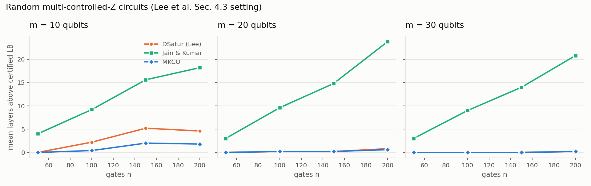
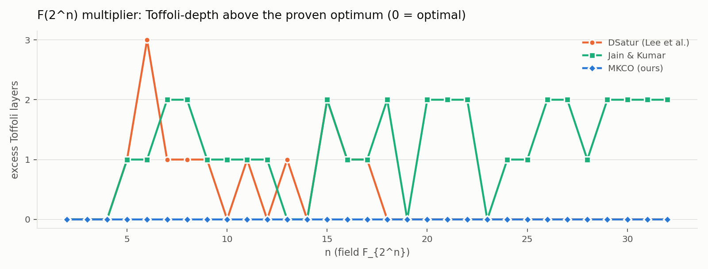
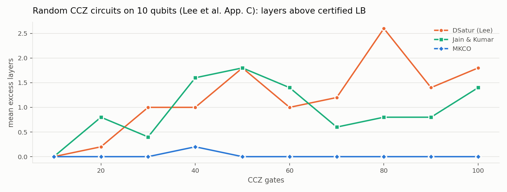
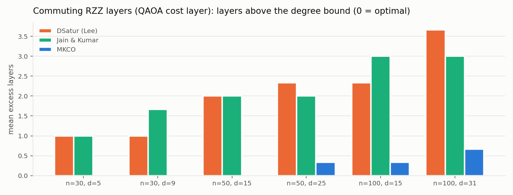
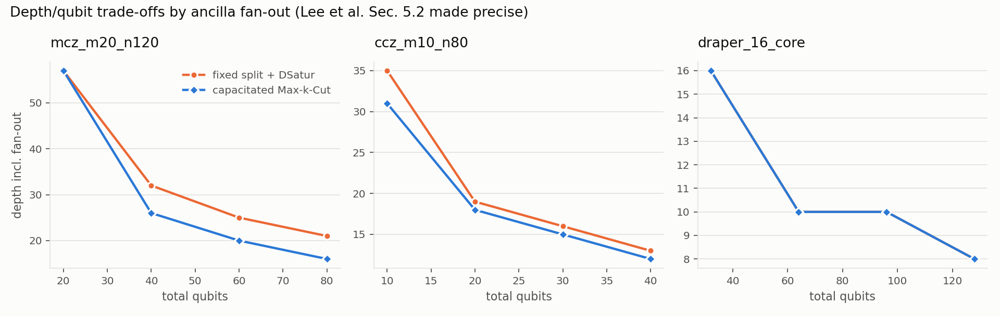

These experiments reproduce the settings of Lee et al. They are the regime
where the *search* component of MKCO matters, because the conflict graphs are
not trivially colourable.

- **E1 – the paper's random benchmark (Fig. 1 setting: m = 10/20/30 qubits,
  n = 50–200 multi-controlled-Z gates, 5 seeds each, 60 circuits).**
  - MKCO is certified optimal on **41/60** (DSatur 36/60, JK 0/60). It is
    strictly better than DSatur on 14 circuits and never worse.
  - Its average excess over the certified bound is 0.57 layers, against 1.23
    for DSatur and 12.2 for JK.
  - The gains concentrate at m = 10, where the paper hypothesised ordering is
    *easier*: at n = 150–200 DSatur sits 4.6–5.2 layers above the bound and
    MKCO only 1.8–2.0.
  - For m = 20/30 the conflict graphs are near-cliques, and DSatur is already
    within 0–0.8 layers of the maximum clique on average. This answers the
    paper's open question of how far DSatur is from exact as n grows: little for
    m ≥ 20, several layers for m = 10.
  - Where the paper's backtracking finishes (n = 50, 15 circuits), MKCO equals
    the proven optimum on every one.
  - **E7 – Lovász-θ certificates.** For the instances the clique/Jackson bound
    left open, the θ number of the complement graph (an SDP, solved with
    Clarabel) raises the certified bound.
    - Computed for all 15 open instances with ≤ 150 gates, it proves MKCO
      optimal on 6 more E1 circuits, raising E1's certified count from 41/60
      to **47/60**. The one open E3 circuit stays open (θ does not reach
      MKCO's depth there).
    - The 5 open 200-gate instances were not attempted: the interior-point SDP
      time grows steeply with size (about 3–6 min at 150 gates on this laptop).
    - θ never exceeded a proven chromatic number in the sanity tests.

- **E2 – the paper's own application (F₂ⁿ multiplication).**
  - MKCO's Toffoli-depth is optimal at all **34** field sizes, n = 2…64:
    - n ≥ 6: certified by the bound 2n−1;
    - n ≤ 5: proven by exhaustive backtracking, which gives 4, 6, 8, 10,
      confirming the paper's remark that 2n−1 is unreachable for n < 6.
  - DSatur, as used by Lee et al., is sub-optimal at 10 sizes
    (n = 5–9, 11, 13, 15–17; e.g. n = 6: 14 vs 11). This matches the paper's
    footnote 2.
  - Jain & Kumar's layering is sub-optimal at 27 sizes.

- **E3 – Appendix C (random CCZ on 10 qubits).** MKCO is certified optimal on
  49/50 circuits (DSatur 20/50, JK 17/50), strictly better than DSatur on 30,
  and never worse. Where 10 s of backtracking could prove the optimum
  (19 circuits), MKCO equals it. At 40–50 gates MKCO also beats
  time-limited backtracking.

- **E4 – commuting two-qubit layers (QAOA cost layers = edge colouring).**
  MKCO reaches Vizing's lower bound Δ on 14 of 18 graphs. DSatur and JK never
  do: they land 1–3.7 layers above Δ on average.
- **E5 – quantum-ready path.** Hierarchical Max-Cut with a QAOA backend (p = 3,
  state-vector) solved every Ising sub-problem to optimality (21/21) and
  produced the same layering as exact enumeration. The log encoding needs
  20–64 spins where one-hot colouring needs 40–176. HMC is optimal on all 4
  instances. On gf2_4 it gives 5 layers against a bound of 4, but exhaustive
  backtracking proves 5 is the optimum, so the bound is loose there.

- **E6 – depth/qubit trade-offs (paper §5.2, made precise).** Fanning wires
  out into c copies turns layering into capacitated Max-k-Cut. Against a fixed
  round-robin copy split coloured by DSatur, MKCO is never worse and is up to
  24% shallower (mcz_m20_n120, c = 4: 21 → 16), fan-out CNOT layers included.
  The constructions are verified exactly by simulation (fidelity 1.0) on the
  instances small enough to simulate.
